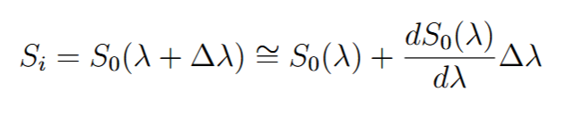
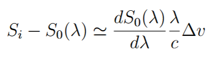
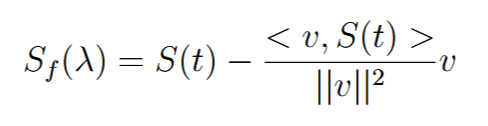

# DOCUMENTATION

## I. Important terms

- TS: time-series of spectra. There are 20 available, with 3686 timesteps and 122 wavelength bins each.
- RV: radial velocities.
- PC: principal component.
- Loadings: variation that each wavelength bin contributes to the variation of the PC.
- Scores: temporal coefficients of the PC.
- Preprocessing: subtraction of the Doppler vector, then double centring.
- $S_p$: preprocessed spectra (see section II for a detailed explanation).
- Pseudo-scores: projection of $S_f$ of a TS over the loadings of another TS.
- Linear model: models the RVs by $RV = I \cdot \alpha$, where $I$ are the scores (or pseudo-scores) and $\alpha$ is a parameter vector.
- Train-test split: means that the first 70% of the TS is used to train the model, and the last 30% to test it.

## II. Subtracting the projection of a TS over the Doppler vector

 First represent each spectrum of the TS as a slightly shifted version of a reference spectrum:
    

Using the Doppler shift formula $\Delta v / c = \Delta \lambda / \lambda$, yields:

Where $S_i$ is one spectrum and $S_0$ is the reference spectrum (also called mask).
We define $S(t) = S_i - S_0(\lambda)$ and the Doppler vector $D = \frac{dS_0(\lambda)}{d\lambda} \frac{\lambda}{c}$. Replacing on the previous equation yields:

Where $<D, S(t)>$ is the inner product. The PCA is always applied after double centring a matrix where each row is an $S_f$.

## III. Double centring

## IV. Linear model tests

Some different methods for building a linear model are tested.

Files content:

1. linear_testing.ipynb:
    - Preprocessing and PCA applied to all TS.
    - Trains the model using the scores of a selected TS, obtaining the parameter vector $\alpha$.
    - Tests the model using that same $\alpha$ on the corresponding scores of the other TS.
    - This method is the most rigid, and gives the worst results compared to the other ones.

2. linear_testing_2.ipynb:
    - Splits a chosen TS in two halves: TSXA and TSXB, where X is the number of the selected TS.
    - Preprocessing and PCA are applied to each half independently.
    - Train-test splits TSXA.
    - Trains the model using the pseudo-scores of TSXA. Using the scores instead gives the same result for $\alpha$, as the loadings used are those from TSXA. This $\alpha$ stays fixed for all tests.
    - Tests the model on the last 30% of TSXA, using pseudo-scores. As this is still TSXA, using scores or pseudo-scores gives the same result.
    - Calculates the pseudo-scores of TSXB and the other TS, using the loadings of TSXA.
    - Tests the model on TSXB and the other TS.
    - This method has some rigidness (as $\alpha$ is fixed) and gives good results.

3. linear_testing_3.ipynb:
    - Splits a chosen TS in two halves: TSXA and TSXB.
    - Preprocessing and PCA are applied to TSXA.
    - Calculates the pseudo-scores of each TS, using the loadings from TSXA.
    - Train-test splits all TS (including TSXA and TSXB).
    - Trains a different $\alpha$ for each TS, using the corresponding pseudo-scores.
    - Tests each $\alpha$ using the test sample of the corresponding TS.
    - This method is flexible (as each TS has a different $\alpha$) and gives good results.

4. linear_testing_4.ipynb:
    - Preprocessing and PCA are applied to each TS.
    - Train-test splits every TS.
    - Uses the scores of each TS to train the model, giving a different $\alpha$ for each TS.
    - Tests each $\alpha$ using the test sample of the corresponding TS.
    - This is the most flexible method, and gives good results.

Results from methods 2, 3 and 4 are similar.